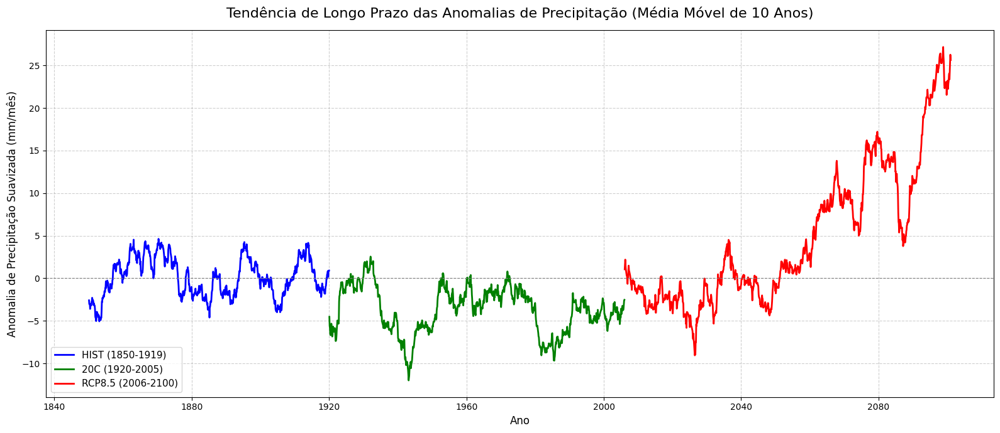
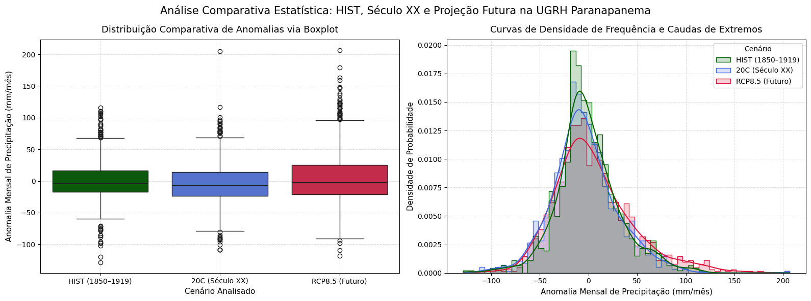

# Precipitation Change in the Paranapanema Basin (Brazil) under RCP8.5

**English** | [Português](README.pt-BR.md)

Course project — *Climate Change* (Mudanças Climáticas), Water Resources and Environmental Engineering, Universidade Federal Fluminense (UFF), Brazil.

## Summary

This project analyzes simulated monthly precipitation over the Paranapanema water-resources management unit (UGRH Paranapanema, São Paulo/Paraná, ~100,800 km²) across three periods of a 40-member global climate-model ensemble: an early-historical period (HIST, 1850–1919), the 20th century (20C, 1920–2005) and a high-emission future scenario (RCP8.5, 2006–2100). Monthly anomalies relative to the HIST seasonal cycle were analyzed for long-term trends, stationarity (ADF and KPSS tests), changes in variability, temporal memory and distribution. In the selected ensemble member, HIST and 20C behave as stationary series with no linear trend, whereas under RCP8.5 the mean, variance and upper tail of monthly precipitation all increase, and the KPSS test rejects stationarity of the mean.

## Data

All three datasets are **climate-model output** (no observations are used), provided as part of the course as daily basin-mean precipitation:

| Period | Years | Content |
|---|---|---|
| HIST | 1850–1919 | Early-historical simulation (reference climatology) |
| 20C | 1920–2005 | 20th-century simulation, 40 ensemble members |
| RCP8.5 | 2006–2100 | High-emission projection, same 40 members |

The data files are not redistributed here; see [`data/README.md`](data/README.md).

## Methods

1. **Pre-processing:** removal of 29 February (calendar standardization) and aggregation of daily values to monthly totals.
2. **Member selection:** the 12-month climatology of each of the 40 members (20C) was correlated with the HIST climatology; the member with the highest correlation (`member_103`, r = 0.9993) was used for 20C and RCP8.5. A single member was used, rather than the ensemble mean, to preserve realistic variability.
3. **Anomalies:** monthly precipitation minus the HIST monthly climatology.
4. **Trend and low-frequency signal:** ordinary least-squares trend of the monthly anomalies, and 13-month and 10-year moving averages.
5. **Stationarity:** Augmented Dickey-Fuller (H0: unit root) and KPSS (H0: level stationarity) tests, α = 0.05.
6. **Variability and memory:** 10-year (120-month) rolling variance, ACF and PACF up to 36 lags.
7. **Distribution:** boxplots and kernel density estimates of the anomalies.

Implemented in Python (pandas, NumPy, statsmodels, matplotlib, seaborn).

## Results

**Seasonal cycle (HIST):** wet summer and dry winter, from 215 mm in January to 17 mm in July.

| Statistic (monthly precipitation) | HIST | 20C | RCP8.5 |
|---|---:|---:|---:|
| Mean (mm) | 97.9 | 94.2 | 102.8 |
| Standard deviation (mm) | 76.3 | 76.0 | 84.5 |
| Maximum (mm) | 324.9 | 307.3 | 378.8 |
| Linear trend of anomalies (mm/month per month) | −0.001 | −0.002 | +0.021 |

| Period | ADF (unit root) | KPSS (level stationarity) | Interpretation |
|---|---|---|---|
| HIST | rejected (p < 0.01) | not rejected (p ≥ 0.10) | stationary |
| 20C | rejected (p < 0.01) | not rejected (p ≥ 0.10) | stationary |
| RCP8.5 | rejected (p < 0.01) | rejected (p ≤ 0.01) | no unit root, but non-constant mean (trend) |

Key findings:

- **HIST and 20C** show no meaningful linear trend; the 20C mean is slightly below the HIST reference.
- **RCP8.5** shows a positive trend (≈ +25 mm/month per century), with decadal-mean anomalies rising to about +25 mm/month by the end of the century.
- **Variability increases** under RCP8.5: the 10-year rolling variance reaches values well above those of HIST and 20C, and the distribution has a heavier upper tail (more very wet months).

<p align="center">
  
  <br><em>10-year moving average of monthly precipitation anomalies (relative to the HIST climatology). Labels in Portuguese.</em>
</p>

<p align="center">
  
  <br><em>Distribution of monthly anomalies: boxplots (left) and density curves (right). Labels in Portuguese.</em>
</p>

## Limitations

- **Model output only.** All periods are simulations; no observations or bias correction were used, so absolute values describe the model climate, not the observed climate of the basin.
- **Single ensemble member.** Results come from one realization; part of the signal may reflect the model's internal variability. All members have very similar seasonal climatologies (r ≈ 0.99), so the selection criterion distinguishes them only weakly.
- **Basin-mean series.** Spatial differences within the basin are not resolved.
- **Trend significance.** The linear trends are descriptive (OLS slope); no significance test was applied to them. Some KPSS p-values lie at the bounds of the test's look-up table (0.01 and 0.10).

## Repository structure

```
├── notebooks/
│   └── paranapanema_precipitation_CMIP5.ipynb   # full analysis (Google Colab), with outputs
├── data/
│   └── README.md                                # data description
├── figures/                                     # figures used in this README
├── README.pt-BR.md                               # Portuguese version of this README
├── requirements.txt
└── LICENSE
```

## How to reproduce

The notebook runs in **Google Colab** and reads the three `.parquet` files from Google Drive.

1. Place `paranapanema-hist.parquet`, `paranapanema-20c.parquet` and `paranapanema-rcp85.parquet` in `MyDrive/Mudanças Climáticas/`.
2. Open the notebook in Colab and run all cells in order.

To run elsewhere, install the dependencies with `pip install -r requirements.txt` and change the folder path in the first code cell.

## Author

- **Maria Vitória Berrêdo Muniz** — Universidade Federal Fluminense (UFF), Niterói, Brazil
- Course: *Mudanças Climáticas* (Climate Change), taught by Prof. André Belém

## License

Code released under the [MIT License](LICENSE). The climate data were provided for the course and are not included.
